<div align="center">

# ESP Box Assistant

**Tap, ask, hear the answer.**<br/>
A voice AI assistant for the ESP32-S3-BOX-3 that you manage entirely from a webpage.

[](https://github.com/Sahnijatin/esp-box-assistant/actions/workflows/firmware.yml)


</div>

<br/>

Flash it once over USB, and the box never needs a laptop again. The AI provider, API keys, language, Wi-Fi networks and firmware updates are all changed from a setup page. Push to `main` and every box updates itself, and rolls back on its own if the new build misbehaves.

It speaks English, Hindi and Hinglish, and shows Devanagari properly on screen, which the box's display library can't do by itself.

<br/>

<picture>
  <source media="(prefers-color-scheme: dark)" srcset="docs/assets/architecture-dark.svg">
  
</picture>

<br/>

## Highlights

- **Managed from the web.** Pick the brain, ears and voice, add API keys, add Wi-Fi networks, pair boxes and roll out updates from one page. Changes reach each box at its next check-in.
- **Keys never touch the device.** API keys live in Supabase Vault. The box is a thin client with its own device token.
- **Zero-touch updates.** GitHub Actions builds every push and publishes it using GitHub's OIDC identity, so no secrets are stored in GitHub. Boxes download, reboot and confirm. A build that crashes or can't reach the server is rolled back by the bootloader.
- **Hindi done right.** Replies with non-Latin text are shaped server-side with HarfBuzz and Noto Sans Devanagari, then sent to the box as a ready-to-draw bitmap.
- **Hinglish mode.** The screen shows Roman script, while the voice gets Hindi words in Devanagari, so Indian voices pronounce it naturally.
- **Any model, no code changes.** Model and voice names are free text, so new releases work the day they ship.

<br/>

## Using the box

1. **Install.** On the setup page, open Updates, choose **Prepare installer**, then **Install on box** (Chrome or Edge, box on USB-C). The installer sends your Wi-Fi details to the box over USB ([Improv Wi-Fi](https://www.improv-wifi.com/serial/)).
2. **Pair.** The box shows a 6-digit code. Enter it on the setup page under Boxes.
3. **Ask.** Tap the button and speak. It stops listening after about a second of silence, or when you tap again.

No Wi-Fi on first boot? The box shows a Wi-Fi screen on its touchscreen and opens a hotspot, `ESP-Box-XXXX` (setup at `http://192.168.4.1`).

<br/>

## Languages

| Setting | Screen | Voice |
| :-- | :-- | :-- |
| English | English text | English |
| Hinglish | Roman script ("Haan, Delhi India ki capital hai") | Hindi words in Devanagari, English words in Latin |
| Hindi | Devanagari, drawn by the server | Hindi |
| Auto | Matches the language spoken | Matches the reply |

<br/>

## Providers

| Slot | Providers |
| :-- | :-- |
| Brain (chat) | OpenAI, Anthropic, Google Gemini, Groq, OpenRouter, Sarvam AI |
| Ears (speech to text) | OpenAI, Groq, ElevenLabs, Gemini, Sarvam AI (`codemix` mode for Hinglish) |
| Voice (text to speech) | OpenAI, ElevenLabs, Gemini, Sarvam AI (`bulbul` voices) |

All audio sent to the box is 24 kHz, 16-bit mono PCM.

<br/>

## How updates ship

```
push to main ─▶ GitHub Actions (espressif/idf:v5.4.2) ─▶ version 0.1.<run>
            ─▶ OIDC-verified upload to a private bucket ─▶ box checks in, sees a newer build
            ─▶ downloads, reboots, confirms ─▶ or the bootloader rolls back
```

- A build that keeps failing, or gets rolled back, is skipped until the next build or until you press **Retry update**.
- **Update to vX** under Boxes installs the latest build on one box at its next check-in, even with automatic updates off.
- Failed CI builds show up on the setup page under Updates, with the log.

<br/>

## Repository

```
firmware/                  ESP-IDF 5.4 app: LVGL 9 UI, Wi-Fi manager, Improv Wi-Fi, audio, OTA with rollback
supabase/functions/api/    Edge Function: device, admin and CI routes; provider adapters; Hindi renderer
supabase/migrations/       Database schema
web/index.html             Setup page (one static file, deployed on Vercel)
.github/                   Firmware build workflow and publish script
```

<br/>

## Security

- A paired box is bound to its device token. A reflashed or copied box can't take over an existing pairing; it shows "Box was reset" and must be removed and paired again.
- The setup page logs in with a bcrypt-hashed password and keeps only a hashed, revocable session token. Logins are rate limited.
- Every table has row-level security on with no policies; only the Edge Function touches data.
- CI can publish only from this repository's `main` branch, verified by GitHub OIDC.

<details>
<summary><b>API reference</b></summary>

<br/>

| Route | Caller | Auth |
| :-- | :-- | :-- |
| `POST /device/hello` | Box check-in: pairing, config, Wi-Fi list, update offer | Device id and token |
| `POST /device/ask` | WAV in, `{question, answer, speech?, render}` out | `X-Device-Id`, `X-Device-Token` |
| `POST /device/tts` | Text in, PCM stream out | Same |
| `POST /device/render` | `{question, answer}` in, `[w u16][h u16]` + RGB565 pixels out | Same |
| `POST /admin/login` | Setup page: password in, session token out | Admin password, rate limited |
| `POST /admin/*` | Setup page | `Bearer <session token>` (30 days, revoked on logout or password change) |
| `POST /ci/*` | GitHub Actions | GitHub OIDC token from this repo's `main` branch |

</details>

<details>
<summary><b>Run your own backend</b></summary>

<br/>

1. Create a Supabase project and apply `supabase/migrations/*.sql` in order (`supabase db push`, or the SQL editor). Apply `0002_hardening.sql` before deploying the matching Edge Function and setup page, and deploy those two together.
2. Deploy the Edge Function: `supabase functions deploy api --no-verify-jwt`.
3. Set `API` in `web/index.html` to your function URL, then deploy `web/` as a static site (Vercel or any host).
4. Point the `API` URL in `.github/workflows/firmware.yml` at your function, and set `ALLOWED_REPO` in `supabase/functions/api/index.ts` to your repository.
5. Add API keys on the setup page for the providers you choose.

Local firmware build:

```bash
cd firmware
idf.py set-target esp32s3
idf.py build flash monitor
```

</details>

<br/>

## Known limits

- The render font covers Hindi and Latin only. Tamil, Bengali and other scripts need another Noto font added in `render.ts`.
- The Sarvam AI integration is built from Sarvam's API docs and still needs a first test with a real key.
- No wake word yet ("Hi ESP" is planned); the trigger is tap-to-talk.

Issues and pull requests are welcome.
